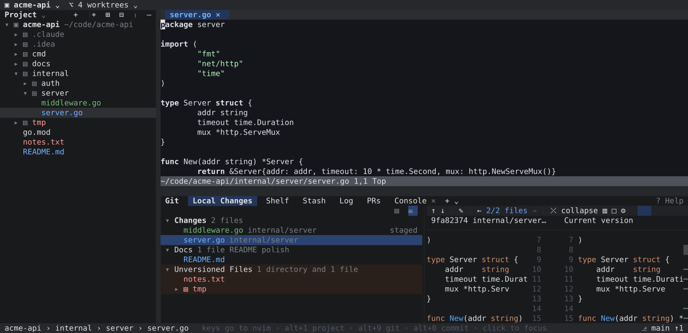

# ideagit

IntelliJ IDEA's Git tool window — the legacy commit UI — as a terminal app.

If your hands know `Ctrl+K`, `F7` and the Local Changes tree, ideagit should feel
familiar: same tabs, same dialogs, same diff viewer, same context menus. Keyboard
and mouse both work everywhere (click, double-click, right-click menus, wheel,
draggable splitters).

<table>
<tr><td></td><td></td></tr>
<tr><td align="center">Log</td><td align="center">Commit Changes (<code>Ctrl+K</code>)</td></tr>
<tr><td></td><td></td></tr>
<tr><td align="center">Diff viewer</td><td align="center">Worktrees with live Claude Code sessions</td></tr>
<tr><td></td><td></td></tr>
<tr><td align="center">Project tree + embedded Neovim (<code>Alt+1</code>)</td><td align="center">Branches popup (<code>b</code>)</td></tr>
<tr><td></td><td></td></tr>
<tr><td align="center">Stash</td><td></td></tr>
</table>

## Features

**Local Changes**
- Changelists (create, move files with `F6`, set active), Unversioned Files, Merge Conflicts
- Diff preview next to the tree, speed search (`/`)
- Tree or flat list: the toggle on top of every changed-files list (or `g`) switches
  them all, with expand/collapse all in tree view
- Rollback, Add to VCS, Add to .gitignore, Shelve, Stash, Show History, Jump to Source
- Banner with Continue / Skip / Abort while merging or rebasing

**Commit Changes dialog** (`Ctrl+K`)
- File checkboxes plus per-chunk checkboxes in the diff for partial commits
- Amend, Sign-off, Author, Run Git hooks, Check TODO, commit message history
- Commit / Commit and Push. Exactly the checked files and chunks are committed (built
  in a temporary index), so anything else you staged stays staged

**Shelf** — reads and writes IntelliJ's own `.idea/shelf` format, so shelves are
shared with the IDE. Unshelve falls back to a three-way merge when files diverged.

**Stash** — list with branch tags, changed files, Apply / Pop / Drop / Unstash as branch,
"Current version vs Stash" diff.

**Log**
- Colored lane graph laid out like IntelliJ's: long edges collapse to ↓/↑ arrows and
  lanes pack to the left; merges dimmed, your own commits' author in bold
- Ref labels, author/committer marker, Today/Yesterday dates
- Filters: text or hash (regex, match case), Branch, User (`me`), Date, Paths — each tab
  remembers its filters; open more Log tabs with the `+` next to the tabs
- Collapsible Branches tree, commit details with changed files and containing branches
- Cherry-pick, Checkout Revision, Reset to Here, Revert, Undo Commit, Edit Message,
  New Branch/Tag, Compare with Local

**Project and editor** — `Alt+1` opens IntelliJ's Project tool window (the file tree,
colored by git status); files open in an embedded **Neovim** (your own config and
plugins) above the Git tool window, with editor tabs for open buffers. `Alt+9` shows or
hides the Git tool window, `F4` jumps to source from anywhere. Without nvim, files open
in a read-only highlighted viewer.

**Pull Requests** — a PRs tab next to the Log, through the GitHub CLI (`gh`): state,
checks, review decision, labels, author, and which local worktree has the branch
checked out (with its Claude Code session). Filter by state, author (`me`), review
(needs my review / reviewed by me / involves me), label and base, or search. The
details pane shows changed files, reviewers, failing checks, mergeability and the
description; `⏎` opens the full diff in a file-tree diff window (fetched from
`refs/pull/N/head`, diffed against the merge base like GitHub). Checkout, checkout into
a new worktree, approve, request changes, comment, re-run failed checks, add/remove
labels (`l`, or Labels › in the context menu, including creating a new one), merge,
draft/ready, close/reopen and create a PR from the current branch. PRs you've viewed are
cached, so switching between them is instant while a fresh copy loads. `ideagit --pr 123` (or a PR URL) opens straight
onto that PR; `ideagit --pr` opens your open PRs.

**Favorites** — star branches (main/master by default); they're listed first with a gold
tag, as in IntelliJ.

**Sessions** — each repository and worktree keeps its tabs, filters, selections, expanded
folders and open editor files across restarts and project switches. `ideagit --pr` is a
session of its own (PRs only, no editor or Project tree) with its own filter, so it never
changes the normal one.

**Text selection** — drag over details, diffs, the console or any text field to select
and copy (on release, or `Ctrl+C`). In lists and trees, where a drag already means
something, use `Shift`+drag.

**Search Everywhere** — double `Shift` (as in IntelliJ) or `Ctrl+P`: fuzzy search over
files, branches, commits and actions, with All / Files / Git / Actions tabs. Double
Shift needs a terminal with the kitty keyboard protocol (Ghostty, kitty, WezTerm);
`Ctrl+P` works everywhere.

**File icons** — Nerd Font icons (same glyphs and colors as nvim-web-devicons) in every
file list. On by default in Ghostty, kitty and WezTerm, which bundle the symbols; set
`"icons": "nerd"` or `"none"` to override.

**Diff viewer** — side-by-side or unified, syntax and word-level highlighting,
`F7`/`Shift+F7`, apply/revert chunks with `>` `<` `a` (or click `»` `«`), collapse unchanged fragments,
whitespace modes, scrollbar with change markers.

**Branches popup** (`b`), Push dialog, Update Project, Conflicts, VCS Operations,
Console with every git command run.

**Projects and worktrees** — a title bar to switch between repositories and
worktrees in place. The worktree window groups worktrees by origin (main, Claude Code
agents, Claude worktrees, other checkouts), shows branch, uncommitted changes,
ahead/behind and merged state, and which worktrees have a **Claude Code session
running** — working or idle — with its last prompt. Clean up merged worktrees in bulk
(ones with live sessions are kept), open a shell or IntelliJ in any of them.

## Install

Download a build for macOS or Linux from [Releases](https://github.com/razkevich/ideagit/releases):

| Platform | Package |
| --- | --- |
| macOS (Apple Silicon / Intel) | `ideagit_<version>_darwin_arm64.tar.gz` / `_darwin_x86_64.tar.gz` |
| Debian, Ubuntu | `sudo apt install ./ideagit_<version>_amd64.deb` |
| Fedora, RHEL, openSUSE | `sudo rpm -i ideagit_<version>_amd64.rpm` |
| Alpine | `sudo apk add --allow-untrusted ideagit_<version>_amd64.apk` |
| Arch | `sudo pacman -U ideagit_<version>_amd64.pkg.tar.zst` |
| Any Linux (static binary, x86_64 / arm64 / armv7) | `ideagit_<version>_linux_*.tar.gz` |

On macOS, if Gatekeeper blocks the unsigned binary: `xattr -d com.apple.quarantine ideagit`.

Or with Go 1.26+: `go install github.com/razkevich/ideagit@latest`

Requires git. Run `ideagit [dir]`; press `?` for every shortcut.

To land in the last worktree you switched to after quitting, add to your shell rc:

    ig() { local f=$(mktemp); IDEAGIT_CD_FILE=$f ideagit "$@"; [ -s "$f" ] && cd "$(cat "$f")"; rm -f "$f"; }

## Keys

IntelliJ's **Windows/Linux keymap** (terminals can't send ⌘), plus lazygit-style
single keys for git. The focused pane gets a key first, so a letter can mean
something local (e.g. `c` cherry-picks in the Log and commits elsewhere).

| IntelliJ | git-style | Action |
| --- | --- | --- |
| `Ctrl+K` | `c` (`A` amend) | Commit |
| `Ctrl+Shift+K` | `P` | Push |
| `Ctrl+T` | `p` | Update Project (pull) |
| | `f` | Fetch |
| ``Ctrl+Shift+` `` | `b` | Branches |
| ``Alt+` `` | `` ` `` | VCS Operations |
| `Ctrl+Alt+Z` | `d` | Rollback |
| | `space` / `a` | Stage / unstage, stage |
| `Ctrl+D` | `⏎` | Show Diff |
| `F4` | `e` | Jump to Source |
| `F6` | `m` | Move to Another Changelist |
| | `M` / `R` | Merge / Rebase |
| | `S` · `z` / `s` | Stash all · stash / shelve the selection (Local Changes) |
| | `w` | Worktrees |
| `Shift` `Shift` | `Ctrl+P` | Search Everywhere |
| `Ctrl+Shift+A` / `Ctrl+Shift+N` | | Find Action / Go to File |
| `Ctrl+1` / `Ctrl+9` / `Ctrl+0` | | Project / Git tool window / Commit (IntelliJ's ⌘ keys map to Ctrl) |
| `Ctrl+Shift+O` / `Ctrl+↓` | | Go to File / Jump to Source |
| `Shift+Esc` / `Alt+F1` | | Hide tool window / Select Opened File |
| `F7` / `Shift+F7` | `n` / `N` | Next / previous difference |
| `Shift+F10` | `x`, `.` | Context menu |

Ctrl+Shift combinations, Ctrl+Enter, Shift+Esc and double Shift need the kitty keyboard
protocol (Ghostty, kitty, WezTerm); the single keys work in any terminal. Press `?` for
the full list.

## Configuration

Settings live in `~/Library/Application Support/ideagit/settings.json` (or
`$XDG_CONFIG_HOME/ideagit` on Linux). Set `"theme": "light"` or `"dark"` to override
detection. Changelists are stored per repository in `.git/ideagit/changelists.json`
and imported once from `.idea/workspace.xml`.

## Development

    go test ./...
    ideagit -snapshot 160x40 -tab 3 -keys "down enter"   # render a frame as text
    ./scripts/screenshots.sh                             # regenerate docs/*.svg from a demo repo

Releases are built by GoReleaser when a `v*` tag is pushed.
