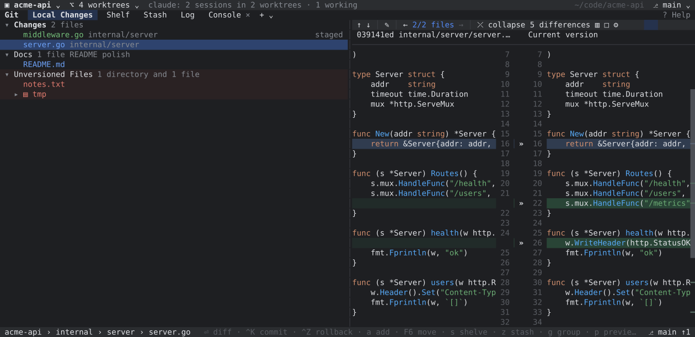
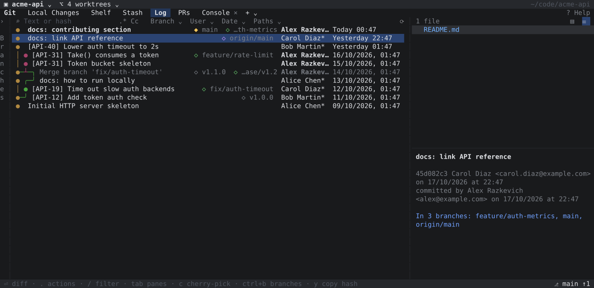
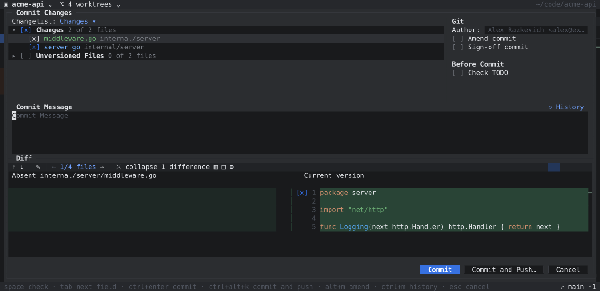
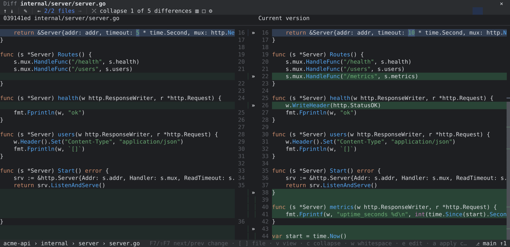
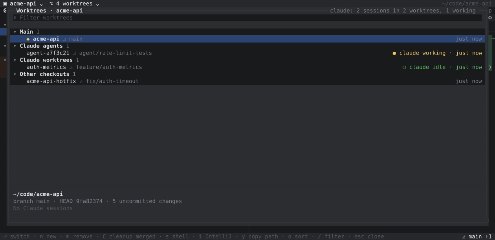
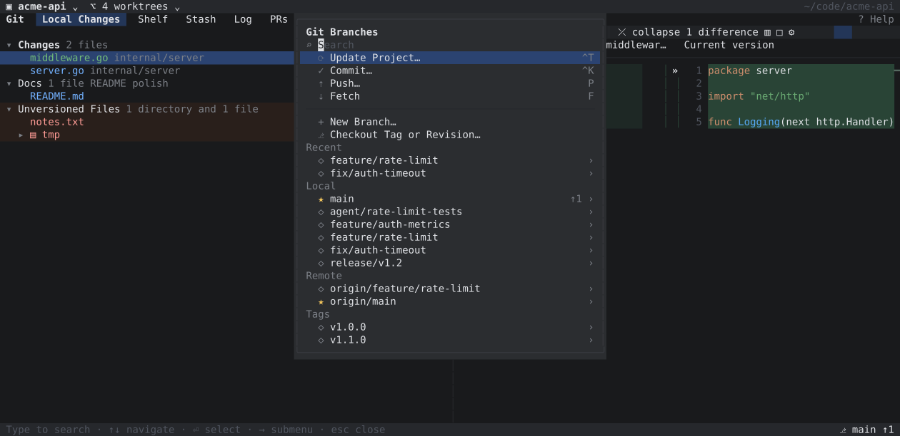
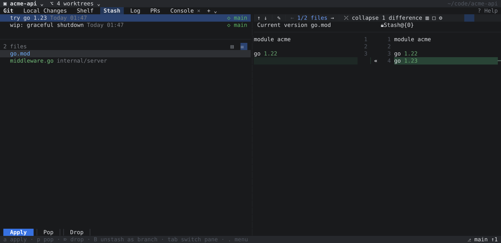

# ideagit

IntelliJ IDEA's Git tool window — the legacy commit UI — as a terminal app.

If your hands know `Ctrl+K`, `F7` and the Local Changes tree, ideagit should feel
familiar: same tabs, same dialogs, same diff viewer, same context menus. Keyboard
and mouse both work everywhere (click, double-click, right-click menus, wheel,
draggable splitters).

<table>
<tr><td></td><td></td></tr>
<tr><td align="center">Log</td><td align="center">Commit Changes (<code>Ctrl+K</code>)</td></tr>
<tr><td></td><td></td></tr>
<tr><td align="center">Diff viewer</td><td align="center">Worktrees with live Claude Code sessions</td></tr>
<tr><td></td><td></td></tr>
<tr><td align="center">Branches popup (<code>b</code>)</td><td align="center">Stash</td></tr>
</table>

## Features

**Local Changes**
- Changelists (create, move files with `F6`, set active), Unversioned Files, Merge Conflicts
- Diff preview next to the tree, group by directory, speed search (`/`)
- Rollback, Add to VCS, Add to .gitignore, Shelve, Stash, Show History, Jump to Source
- Banner with Continue / Skip / Abort while merging or rebasing

**Commit Changes dialog** (`Ctrl+K`)
- File checkboxes plus per-chunk checkboxes in the diff for partial commits
- Amend, Sign-off, Author, Run Git hooks, Check TODO, commit message history
- Commit / Commit and Push. Exactly the checked files and chunks are committed (built
  in a temporary index), so anything else you staged stays staged

**Shelf** — reads and writes IntelliJ's own `.idea/shelf` format, so shelves are
shared with the IDE. Unshelve falls back to a three-way merge when files diverged.

**Stash** — list with branch tags, changed files, Apply / Pop / Drop / Unstash as branch,
"Current version vs Stash" diff.

**Log**
- Colored lane graph, ref labels, author/committer marker, Today/Yesterday dates
- Filters: text or hash (regex, match case), Branch, User (`me`), Date, Paths — each tab
  remembers its filters; open more Log tabs with `+`
- Collapsible Branches tree, commit details with changed files and containing branches
- Cherry-pick, Checkout Revision, Reset to Here, Revert, Undo Commit, Edit Message,
  New Branch/Tag, Compare with Local

**Diff viewer** — side-by-side or unified, syntax and word-level highlighting,
`F7`/`Shift+F7`, apply/revert chunks with `»` `«`, collapse unchanged fragments,
whitespace modes, scrollbar with change markers.

**Branches popup** (`b`), Push dialog, Update Project, Conflicts, VCS Operations,
Console with every git command run.

**Projects and worktrees** — a title bar to switch between repositories and
worktrees in place. The worktree window groups worktrees by origin (main, Claude Code
agents, Claude worktrees, other checkouts), shows branch, uncommitted changes,
ahead/behind and merged state, and which worktrees have a **Claude Code session
running** — working or idle — with its last prompt. Clean up merged worktrees in bulk
(ones with live sessions are kept), open a shell or IntelliJ in any of them.

## Install

Download a build for macOS or Linux from [Releases](https://github.com/razkevich/ideagit/releases):

| Platform | Package |
| --- | --- |
| macOS (Apple Silicon / Intel) | `ideagit_<version>_darwin_arm64.tar.gz` / `_darwin_x86_64.tar.gz` |
| Debian, Ubuntu | `sudo apt install ./ideagit_<version>_amd64.deb` |
| Fedora, RHEL, openSUSE | `sudo rpm -i ideagit_<version>_amd64.rpm` |
| Alpine | `sudo apk add --allow-untrusted ideagit_<version>_amd64.apk` |
| Arch | `sudo pacman -U ideagit_<version>_amd64.pkg.tar.zst` |
| Any Linux (static binary, x86_64 / arm64 / armv7) | `ideagit_<version>_linux_*.tar.gz` |

On macOS, if Gatekeeper blocks the unsigned binary: `xattr -d com.apple.quarantine ideagit`.

Or with Go 1.26+: `go install github.com/razkevich/ideagit@latest`

Requires git. Run `ideagit [dir]`; press `?` for every shortcut.

To land in the last worktree you switched to after quitting, add to your shell rc:

    ig() { local f=$(mktemp); IDEAGIT_CD_FILE=$f ideagit "$@"; [ -s "$f" ] && cd "$(cat "$f")"; rm -f "$f"; }

## Keys

| Key | Action |
| --- | --- |
| `1`…`7`, `{` `}` | Switch tabs |
| `Ctrl+K` / `P` / `U` / `F` | Commit / Push / Update Project / Fetch |
| `b` / `W` / `O` | Branches / Worktrees / Projects |
| `⏎`, double-click | Show diff |
| `.`, right-click | Context menu |
| `F7` / `Shift+F7` | Next / previous difference |
| `v` / `c` / `w` | Unified view / collapse unchanged / whitespace mode |
| `Ctrl+Z` | Rollback |
| `/` | Speed search / log filter |

## Configuration

Settings live in `~/Library/Application Support/ideagit/settings.json` (or
`$XDG_CONFIG_HOME/ideagit` on Linux). Set `"theme": "light"` or `"dark"` to override
detection. Changelists are stored per repository in `.git/ideagit/changelists.json`
and imported once from `.idea/workspace.xml`.

## Development

    go test ./...
    ideagit -snapshot 160x40 -tab 3 -keys "down enter"   # render a frame as text
    ./scripts/screenshots.sh                             # regenerate docs/*.svg from a demo repo

Releases are built by GoReleaser when a `v*` tag is pushed.
